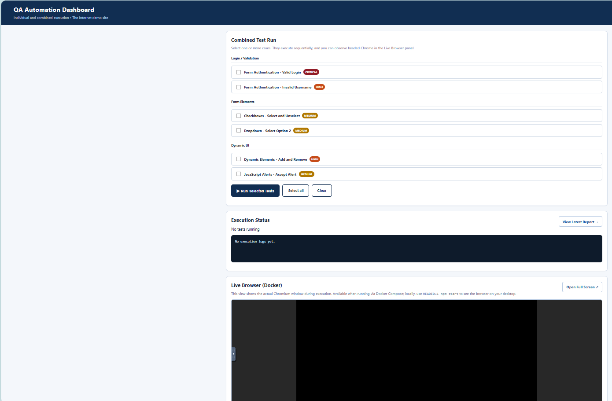
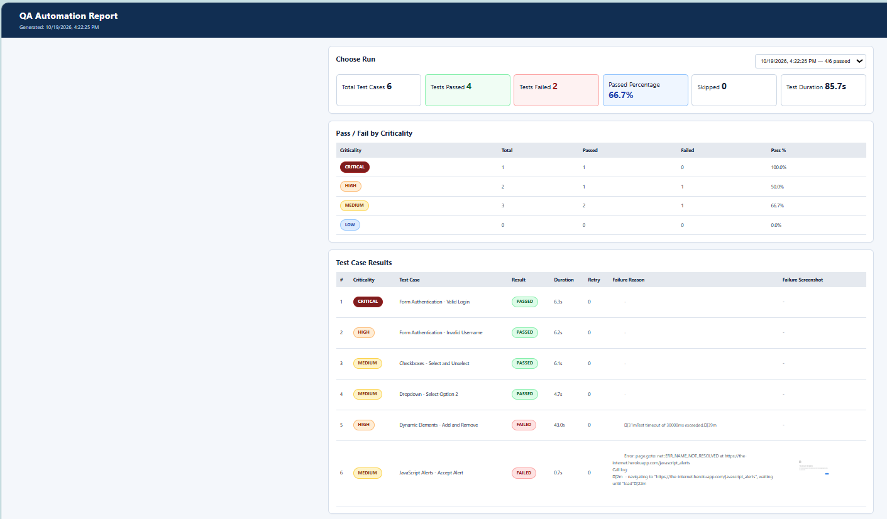

<div align="center">

# The Internet — Playwright QA Dashboard

### Run, watch, and report automated browser tests from one dashboard.

<p>
  
  
  
  
</p>

**A web-based Playwright automation runner** for [The Internet](https://the-internet.herokuapp.com/), featuring individual test selection, sequential suites, a live browser desktop, and beautiful results reporting.

[Features](#-features) · [Screenshots](#-screenshots) · [Quick Start](#-quick-start-with-docker) · [Reports](#-test-reports) · [Troubleshooting](#-troubleshooting)

</div>

---

## ✨ Features

| Feature | What it does |
| :--- | :--- |
| 🎯 **Run individual tests** | Choose exactly which test cases to execute. |
| 🔁 **Combined runs** | Run multiple selected tests sequentially; one failure does not stop the rest. |
| 👀 **Watch tests live** | View headed Chromium through **noVNC** when running with Docker. |
| 📊 **Custom HTML reports** | View run metrics, pass rate, execution time, retries, and detailed case results. |
| 🚦 **Priority at a glance** | Color-coded **CRITICAL**, **HIGH**, **MEDIUM**, and **LOW** levels. |
| 📸 **Failure evidence** | Inspect saved screenshots and other available test attachments. |
| 🗂️ **Run history** | Access earlier results from the report selector. |
| 🐳 **Containerized setup** | Launch the dashboard, browser, and remote desktop using Docker Compose. |

## 🖼️ Screenshots

### Execution Dashboard

Select one or more cases, launch a run, and watch its progress.



### Results Report

Review summary cards, pass/fail by criticality, individual results, and failure evidence.



> **Screenshot paths:** Place `image-1.png` and `image.png` in the repository root alongside `README.md`, or update these paths to match your repository.

## 🚀 Quick Start with Docker

### Prerequisites

- [Docker Desktop](https://www.docker.com/products/docker-desktop/) or Docker Engine with Compose support
- Internet access to [the-internet.herokuapp.com](https://the-internet.herokuapp.com/)
- Available local ports **3000** and **6080**

Clone your repository and start the service:

```bash
git clone <YOUR_REPOSITORY_URL>
cd <YOUR_REPOSITORY_DIRECTORY>
docker compose up --build -d
```

> Replace the placeholders with your actual GitHub repository URL and directory name.

### Open the services

| Service | URL |
| :--- | :--- |
| 🧪 **Test dashboard** | [http://localhost:3000](http://localhost:3000) |
| 🖥️ **Live browser (noVNC)** | [http://localhost:6080/vnc.html?autoconnect=1&resize=scale](http://localhost:6080/vnc.html?autoconnect=1&resize=scale) |
| 📈 **Reports** | [http://localhost:3000/report.html](http://localhost:3000/report.html) |

### Run a test

1. Open the **Test Dashboard**.
2. Select an individual test case or several cases.
3. Click **Run Selected Tests**.
4. Follow the execution log and watch the browser in the **Live Browser** panel.
5. Click **View Latest Report** to inspect results and failure evidence.

### Manage the container

```bash
# Follow application logs
docker compose logs -f qa-dashboard

# Show running services
docker compose ps

# Stop containers without intentionally removing named volumes
docker compose down

# Delete named volumes too (WARNING: may erase report history)
docker compose down -v
```

> **Persistence:** Run history is intended to be stored in the Compose-managed `qa-runs` volume. Avoid `docker compose down -v` when you want to keep historical reports. Check your `docker-compose.yml` for the actual volume configuration.

## 💻 Run Locally (Without Docker)

Install **Node.js 20+** and a supported Chromium browser via Playwright:

```bash
npm install
npx playwright install chromium
npm start
```

Open **http://localhost:3000**. Local runs are headless by default.

### Watch a native browser window

**macOS / Linux:**

```bash
HEADED=1 SLOW_MO=250 npm start
```

**Windows PowerShell:**

```powershell
$env:HEADED='1'
$env:SLOW_MO='250'
npm start
```

> The embedded noVNC viewer is a **Docker-only** feature. Local headed execution opens a native Chromium window instead.

## 🧪 Example Test Coverage

The starter includes **six test cases** across five Playwright spec files.

| Test case | Example validation | Priority |
| :--- | :--- | :--- |
| Form Authentication — Valid Login | Successful login | 🔴 CRITICAL |
| Form Authentication — Invalid Username | Error on invalid username | 🟠 HIGH |
| Checkboxes — Select and Unselect | Checkbox interactions | 🟡 MEDIUM |
| Dropdown — Select Option 2 | Dropdown selection | 🟡 MEDIUM |
| Dynamic Elements — Add and Remove | Dynamic DOM behavior | 🟠 HIGH |
| JavaScript Alerts — Accept Alert | JavaScript dialog handling | 🟡 MEDIUM |

Target application: **https://the-internet.herokuapp.com/**

### Playwright CLI

```bash
# Run the entire Playwright suite
npx playwright test

# Run one spec in a visible browser (requires desktop/display support)
npx playwright test tests/login.spec.js --headed

# List discovered tests
npx playwright test --list

# Open Playwright's built-in HTML report
npx playwright show-report
```

## 📊 Test Reports

The **custom QA Automation Report** is available at [`/report.html`](http://localhost:3000/report.html). It summarizes:

- **Total tests**, **passed**, **failed**, **skipped**, **pass percentage**, and **run duration**.
- **Pass/fail by criticality**: CRITICAL, HIGH, MEDIUM, and LOW.
- **Per-test detail**: status, duration, retry count, error reason, and saved screenshots (when available).
- **Run history** selectable from the report dropdown.

Runs are written under `runs/<run-id>/` inside the application container, including a `summary.json` used by the dashboard report. The specific files and attachments depend on the run and your Playwright reporter settings.

### Useful API endpoints

| Endpoint | Purpose |
| :--- | :--- |
| `GET /api/cases` | Available test cases |
| `GET /api/state` | Current run and execution progress |
| `GET /api/runs` | Saved run summaries |
| `GET /api/runs/:id` | Detailed results for one run |
| `GET /health` | Dashboard service health |

The dashboard submits selected, whitelisted test IDs to the backend; tests are executed sequentially using Playwright's filtering options.

## 🗂️ Project Layout

```text
the-internet-playwright/
├── pages/                 # Page Object Model classes
├── tests/                 # Playwright test specs
├── utils/                 # Shared test data / helpers
├── server/
│   ├── cases.js           # Test registry, priorities, and groups
│   └── index.js           # Runner API and report persistence
├── public/
│   ├── index.html          # Test runner dashboard
│   ├── report.html         # Custom report page
│   ├── report.js           # Report rendering logic
│   └── style.css           # Dashboard and report styling
├── runs/                   # Generated test-run artifacts (when present)
├── playwright.config.js   # Playwright configuration
├── Dockerfile
├── docker-compose.yml
├── package.json
└── README.md
```

## ⚙️ Configuration

| Variable | Purpose | Example |
| :--- | :--- | :--- |
| `BASE_URL` | Site under test | `https://the-internet.herokuapp.com` |
| `PORT` | Dashboard HTTP port | `3000` |
| `HEADED` | Open Chromium visibly | `1` |
| `SLOW_MO` | Delay browser interactions (ms) | `250` |

Environment values can be configured via your Docker Compose configuration or local shell. Some options require the matching Playwright configuration to consume them.

## 🔐 Security Notes

> [!WARNING]
> This project is intended for **local development and controlled QA environments**, not as a publicly exposed test runner.

- The sample dashboard does not provide built-in authentication or HTTPS.
- The container's VNC service has **no password** by default.
- Keep ports **3000** and **6080** bound to trusted interfaces (preferably localhost).
- For shared environments, add authentication, HTTPS, access controls, and secure noVNC behind a protected reverse proxy.
- Do not commit real credentials or local `.env` secrets to GitHub.

## 🧭 Possible Next Steps

- CI/CD execution with GitHub Actions
- Additional browser projects and test scenarios
- Downloadable PDF reports and scheduled email delivery
- Role-based access and protected team deployments
- Trends across historical test runs

---

<div align="center">

**Built with [Playwright](https://playwright.dev/) · [Node.js](https://nodejs.org/) · [Docker](https://www.docker.com/) · [noVNC](https://novnc.com/)**

*Reliable test execution. Clear visibility. Actionable reporting.*

</div>
